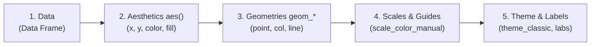

# A Guide to R & Publication-Ready Genomic Plotting

Welcome to the **R Tutorial** for reproducing high-impact publication figures from **Liam C. Hunt et al. (*Cell Reports*, 2021)**.

This guide is designed for beginners who want to go from **R zero** to generating **publication-ready 300 DPI composite figures** using modern R (`ggplot2`, `patchwork`, and Base R).

---

## Tutorial Roadmap & Scripts

All scripts are self-contained, fully commented, and located in the [`tutorial/`](file:///c:/ME/matrophy/tutorial/) folder:

| Script | Level | Topic & What You Will Learn | Output Figure |
| :--- | :---: | :--- | :--- |
| [`01_r_basics_and_data_loading.R`](file:///c:/ME/matrophy/tutorial/01_r_basics_and_data_loading.R) | 🟢 Beginner | Variables, vectors, 1-indexing, data frames, filtering, loading real transcriptomics tables (`read.csv`). | Console summaries |
| [`02_volcano_plots_step_by_step.R`](file:///c:/ME/matrophy/tutorial/02_volcano_plots_step_by_step.R) | 🟡 Intermediate | What is a volcano plot? Layers in `ggplot2`, threshold guidelines, coloring by significance, labeling landmark atrogenes (*Trim63*, *Fbxo32*), stitching panels with `patchwork`. | [`Tutorial_Figure2_Volcano_3Panel.png`](file:///c:/ME/matrophy/tutorial/figures/Tutorial_Figure2_Volcano_3Panel.png) |
| [`03_barplots_and_atrogenes.R`](file:///c:/ME/matrophy/tutorial/03_barplots_and_atrogenes.R) | 🟡 Intermediate | `geom_col()` vs `geom_bar()`, dodging bars side-by-side (`position_dodge`), controlling category sort order using `factor()`, zero baseline lines. | [`Tutorial_Figure2D_2F_Barplots.png`](file:///c:/ME/matrophy/tutorial/figures/Tutorial_Figure2D_2F_Barplots.png) |
| [`04_multiomics_correlation.R`](file:///c:/ME/matrophy/tutorial/04_multiomics_correlation.R) | 🔴 Advanced | Multi-omics scatter plots (RNA vs Protein), adding linear trendlines (`geom_smooth`), computing Pearson $r$ & $R^2$ dynamically, faceting grids with `facet_wrap()`. | [`Tutorial_Figure4A_RNA_Protein_Correlation.png`](file:///c:/ME/matrophy/tutorial/figures/Tutorial_Figure4A_RNA_Protein_Correlation.png) |
| [`05_master_paper_figure.R`](file:///c:/ME/matrophy/tutorial/05_master_paper_figure.R) | 🏆 Master | Stitching multi-row figures (`/` and `|`), automatic panel tags (`A`, `B`, `C`), exporting 300 DPI PNG & vector PDF via `ggsave()`. | [`Tutorial_Master_Paper_Ready_Figure.png`](file:///c:/ME/matrophy/tutorial/figures/Tutorial_Master_Paper_Ready_Figure.png) |

---

## 1. R Fundamentals for Biologists

### A. Assignment Operator (`<-`)
In R, we store values in variables using the arrow `<-`:
```R
sample_name <- "Dexamethasone_Treated_Muscle"
sample_count <- 4
```

### B. Vectors: The Building Blocks of R
A **vector** is a 1-dimensional list of items of the same type, created using `c()` (combine):
```R
# A vector of gene symbols
genes <- c("Trim63", "Fbxo32", "Foxo1", "Cyr61")

# A vector of fold changes
fcs <- c(1.05, 0.92, 0.55, 1.17)
```
> [!IMPORTANT]
> **R is 1-indexed**: Unlike Python or C which start at 0, the first element in R is `genes[1]`.

### C. Vectorized Math (No Loops Needed!)
In R, mathematical operations happen to **every element simultaneously**:
```R
p_values <- c(0.001, 0.045, 0.0001, 0.85)

# Calculate -log10 for all p-values in one shot:
minus_log10_p <- -log10(p_values)
# Result: 3.000000 1.346787 4.000000 0.070581
```

### D. Data Frames: Tabular Biological Data
A `data.frame` is a table where each column is a vector. Columns can have different data types (e.g. text for Gene names, numbers for Fold Changes):
```R
my_de_table <- data.frame(
  Gene = genes,
  log2FC = fcs,
  P_Value = p_values,
  stringsAsFactors = FALSE
)

# Extract a column using the $ operator:
my_de_table$log2FC

# Filter rows where P_Value < 0.05 AND log2FC > 1:
sig_genes <- my_de_table[my_de_table$P_Value < 0.05 & my_de_table$log2FC > 1, ]
```

---

## 2. Loading Real Biological Data

To load tabular CSV files into R:
```R
# check.names = FALSE ensures column names like 'P value' keep their exact spacing
dexa_df <- read.csv("data/supplementary/Table_S1_RNAseq_Dexamethasone.csv", 
                    check.names = FALSE, stringsAsFactors = FALSE)

# Inspect the dimensions (rows, columns)
dim(dexa_df)        # 16,168 genes, 13 columns
head(dexa_df, 3)    # View the first 3 rows
colnames(dexa_df)   # View all column headers
```

---

## 3. The Grammar of Graphics (`ggplot2`)

`ggplot2` builds plots in **layers**, added together with the `+` operator:



### The Golden Rule of `aes()`:
- Put an aesthetic inside `aes()` if it depends on data in a column: `aes(color = Significance)`
- Put an aesthetic outside `aes()` if it is a fixed visual property: `geom_point(color = "grey80", size = 1)`

---

## 4. Step-by-Step Volcano Plotting (Figure 2A-C)

A volcano plot places:
- **X-axis**: Biological effect size $\rightarrow \log_2(\text{Fold Change})$
- **Y-axis**: Statistical significance $\rightarrow -\log_{10}(P\text{-value})$

```R
library(ggplot2)

p <- ggplot(clean_dexa, aes(x = log2FC, y = minusLog10P)) +
  
  # Layer 1: Non-significant genes (grey and semi-transparent)
  geom_point(data = subset(clean_dexa, Significance == "NS"),
             color = "grey85", size = 0.8, alpha = 0.35) +
             
  # Layer 2: Significant genes (colored red or blue)
  geom_point(data = subset(clean_dexa, Significance != "NS"),
             aes(color = Significance), size = 1.2, alpha = 0.85) +
             
  # Layer 3: Threshold guidelines
  geom_vline(xintercept = c(-1, 1), linetype = "dashed", color = "grey40") +
  geom_hline(yintercept = -log10(0.05), linetype = "dashed", color = "grey40") +
  
  # Layer 4: Mathematical axis labels
  labs(
    title = "Dexamethasone Atrophy",
    x = expression(bold(log[2]~"(Fold Change vs Control)")),
    y = expression(bold(-log[10]~"(P-value)"))
  ) +
  
  # Layer 5: Clean publication theme
  theme_classic(base_size = 11)
```

### Multi-Panel Stitching with `patchwork`
Instead of dealing with complex grid systems, `patchwork` lets you combine plots with math operators:
```R
library(patchwork)

# Place 3 volcano plots side-by-side:
volcano_3panel <- p_dexa | p_llc | p_aging
```

---

## 5. Controlling Category Order with Factors (Figures 2D & 2F)

> [!WARNING]
> By default, R sorts categorical labels **alphabetically** (e.g. *Aging* before *Dexamethasone* before *LLC*). To enforce a custom biological order, convert the column into a `factor` with explicit `levels`:

```R
# Order genes by Dexamethasone fold change magnitude:
gene_order <- atrogenes_df$Gene[order(-atrogenes_df$Dex_log2FC)]
atrogenes_long$Gene <- factor(atrogenes_long$Gene, levels = gene_order)

# Grouped bar chart with dodge positioning:
ggplot(atrogenes_long, aes(x = Gene, y = log2FC, fill = Condition)) +
  geom_col(position = position_dodge(width = 0.8), width = 0.75, color = "black") +
  geom_hline(yintercept = 0, color = "black") +
  theme_classic()
```

---

## 6. Multi-Omics Regression & Disconnect (Figure 4A)

To reproduce the study's finding that mRNA changes explain only **8% to 20%** of protein changes:
```R
ggplot(tidy_multi, aes(x = RNA_log2FC, y = Protein_log2FC, color = Condition)) +
  geom_point(alpha = 0.25, size = 1.0) +
  # Adds linear regression line without confidence ribbon:
  geom_smooth(method = "lm", color = "black", linetype = "dashed", se = FALSE) +
  # Splitting into 3 subplots by condition:
  facet_wrap(~ Condition, ncol = 3) +
  theme_classic()
```

---

## 7. Exporting Publication Figures with `ggsave()`

Journals require figures at **300 DPI** in physical dimensions (inches or mm):

```R
# 1. High-resolution raster image (PNG)
ggsave(
  filename = "tutorial/figures/Tutorial_Master_Paper_Ready_Figure.png",
  plot = master_figure,
  width = 17,
  height = 16,
  dpi = 300
)

# 2. Lossless vector graphic (PDF) — ideal for Illustrator/Inkscape
ggsave(
  filename = "tutorial/figures/Tutorial_Master_Paper_Ready_Figure.pdf",
  plot = master_figure,
  width = 17,
  height = 16,
  device = "pdf"
)
```

---

## 8. Common Beginner Pitfalls & How to Avoid Them

| Pitfall | Why It Happens | The Fix |
| :--- | :--- | :--- |
| `P value not found` | Column name contains spaces | Use backticks: `` `P value` `` or access via `df[["P value"]]` |
| Plot is completely blank | Forgot `+ geom_*()` | `ggplot()` only creates the canvas; you must add a geometry layer |
| Bars are in alphabetical order | R sorts text strings A–Z | Use `factor(x, levels = c("First", "Second", ...))` |
| Color didn't change | Put color inside `aes()` as literal | `geom_point(color = "red")` (no `aes` for fixed colors) |
| Legend shows ugly variable names | Default column titles used | Use `labs(fill = "Condition:", color = "Significance:")` |
| Image is blurry | Exported via RStudio Export menu | Use `ggsave(..., dpi = 300)` with explicit `width` and `height` |

---

## 9. How to Run the Tutorial

From the repository root:
```powershell
# Run the master tutorial figure builder
& "C:\Program Files\R\R-4.6.2\bin\Rscript.exe" tutorial/05_master_paper_figure.R
```
Or open any of the tutorial scripts in **Positron**, **RStudio**, or **VS Code** and run them line-by-line using `Ctrl+Enter` to watch each layer appear interactively!

